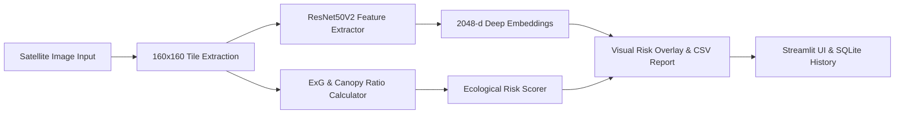

# 🌿 ECOVISION | Northeast Forest Watch

[](https://www.python.org/)
[](https://streamlit.io/)
[](https://www.tensorflow.org/)
[](https://www.sqlite.org/)
[](#disclaimer)

**ECOVISION** is an AI-assisted satellite imagery screening and forest monitoring dashboard tailored for Northeast India, with a regional focus on Nagaland. The platform combines deep learning feature extraction (**ResNet50V2**), spectral vegetation heuristics, and temporal change detection into an interactive Streamlit workspace.

---

## 📌 Key Features

- **🛰️ Single Image AI Screening**
  - Splits input satellite imagery into uniform $160 \times 160$ px tiles.
  - Generates 2048-dimensional deep feature embeddings using a pretrained **ResNet50V2** backbone.
  - Computes the **Excess Green Index (ExG)**, canopy cover ratio, and missing/blank data ratios.
  - Renders a semi-transparent risk overlay classifying landscape patches into actionable categories.
  - Allows full CSV export of per-tile ecological metrics.

- **🔄 Two-Date Comparative Change Detection**
  - Upload earlier and later satellite scenes for side-by-side visual inspection.
  - Adjustable difference threshold sensitivity to flag altered forest canopy, clearings, or new human activity.
  - Calculates total pixel changes and percentage area flagged.

- **📈 Persistent Analytics & Historical Tracking**
  - Built-in **SQLite** database (`data/ecovission.db`) automatically logs every comparative analysis with SHA-256 deduplication.
  - Dynamic Plotly trendlines visualising flagged-pixel percentages across monitoring sessions.
  - Summary metrics tracking total saved comparisons, distinct monitoring zones, and cumulative flagged pixels.

- **🗺️ Regional Monitoring Context**
  - Integrated geospatial monitoring framework covering key administrative districts in Nagaland (Kohima, Dimapur, Mokokchung, Mon, Tuensang, Wokha, Zunheboto, Phek, Peren, Kiphire, Longleng, Noklak).

- **🧪 Built-in Synthetic Demo Mode**
  - Test the entire end-to-end pipeline immediately without needing to download external satellite data.

---

## 🔬 Classification Categories

| Category | Color Badge | Hex Code | Description |
| :--- | :---: | :---: | :--- |
| **Intact Forest** | 🟢 Green | `#2E9D62` | Dense vegetative canopy with high ExG and high canopy fraction. |
| **Degraded / Jhum Scrub** | 🟡 Amber | `#E4B64D` | Mixed vegetation, secondary growth, shifting cultivation (Jhum), or sparse scrub. |
| **Deforested / Cleared Land** | 🔴 Red | `#D96A5F` | Felled timber, exposed soil, roads, agricultural clearings, or built-up areas. |
| **No Data / Blank** | ⚪ Grey | `#7D878C` | Missing pixels, border masks, or uncaptured satellite zones ($>60\%$ near-black). |

---

## 🏗️ Architecture & Pipeline



---

## 📂 Project Structure

```text
ECOVISION/
├── app.py                  # Main Streamlit web application & UI dashboard
├── process_satellite.py    # Deep learning (ResNet50V2), patching, vegetation indices & screening engine
├── requirements.txt        # Python dependency manifest
├── .gitignore              # Excludes virtual environments, large weights, and logs
├── README.md               # Project documentation
│
├── data/                   # Sample satellite imagery and local SQLite DB (ecovission.db)
├── models/                 # Model architecture and weight files (ResNet50V2)
└── outputs/                # Generated comparison overlays and exported CSV reports
```

---

## 🚀 Quick Start Guide

### 1. Prerequisites
- Python **3.10+** (Python 3.10 – 3.12 recommended)
- Git

### 2. Clone Repository & Set Up Environment

```powershell
# Clone the repository
git clone https://github.com/<your-username>/ECOVISION.git
cd ECOVISION

# Create and activate virtual environment
python -m venv .venv

# On Windows (PowerShell):
.venv\Scripts\Activate.ps1

# On macOS/Linux:
source .venv/bin/activate
```

### 3. Install Dependencies

```powershell
pip install --upgrade pip
pip install -r requirements.txt
```

### 4. Run the Streamlit Application

```powershell
streamlit run app.py
```

The application will launch in your default web browser at `http://localhost:8501`.

---

## 🛠️ Tech Stack

- **Frontend & Visualisation**: [Streamlit](https://streamlit.io/), [Plotly Express](https://plotly.com/python/), Custom Dark Theme CSS.
- **Deep Learning & Computer Vision**: [TensorFlow](https://www.tensorflow.org/) (ResNet50V2), [NumPy](https://numpy.org/), [Pillow (PIL)](https://python-pillow.org/).
- **Data Engineering**: [Pandas](https://pandas.pydata.org/), [SQLite3](https://docs.python.org/3/library/sqlite3.html).
- **Geospatial Foundations**: [Rasterio](https://rasterio.readthedocs.io/), [GeoPandas](https://geopandas.org/), [PyProj](https://pyproj4.github.io/pyproj/), [Shapely](https://shapely.readthedocs.io/).

---

## ⚠️ Disclaimer & Interpretation Limits

> **Important Note:**
> ECOVISION is an exploratory decision-support and screening prototype. Classification categories and flagged change zones are derived from RGB spectral indices, tile heuristics, and deep feature representations. They do **not** constitute legal ground-truthed forest department land-use certifications, deforestation citations, or validated carbon stock assessments. Jhum cultivation cycles, seasonal deciduous changes, and cloud/shadow artifacts should always be verified with calibrated multispectral/SAR data and field validation.
